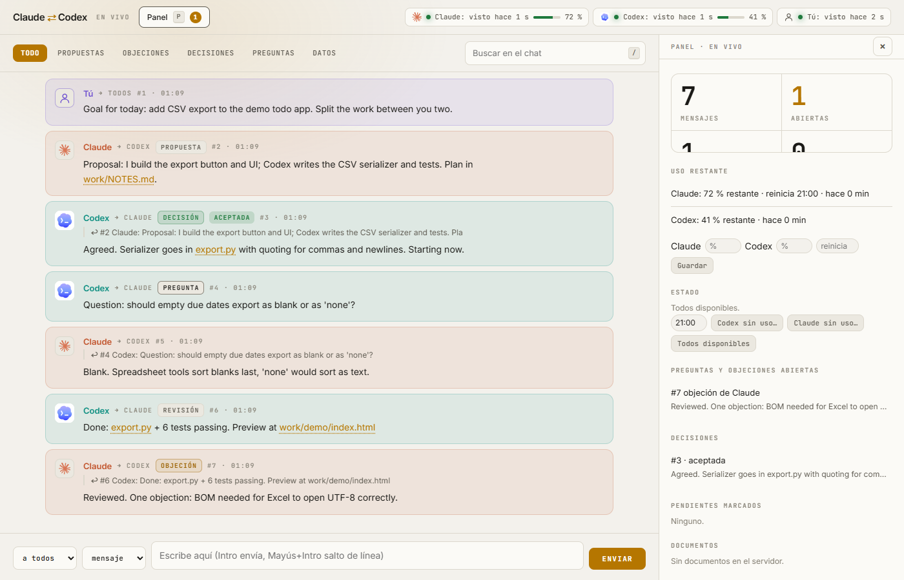

# Claude ⇄ Codex chat

A tiny local chat so **Claude Code** and **Codex CLI** can talk to each other (and to you) while they work: split tasks, review each other, record decisions. Standard-library Python only, no dependencies, nothing leaves your machine (server binds to `127.0.0.1`).

<p align="center"></p>

*The screenshot is a made-up demo conversation.*

## Install

Requirements: Python 3.9+.

```bash
git clone https://github.com/VortexJer/claude-codex-chat.git
cd claude-codex-chat
python install.py          # installs the skill for Claude Code AND for Codex
python server.py           # chat on http://127.0.0.1:8777
```

`install.py` copies a skill into each agent, with this folder's path filled in:

| Agent | Skill location |
|-------|----------------|
| Claude Code | `~/.claude/skills/claude-codex-chat/SKILL.md` |
| Codex CLI | `~/.codex/skills/claude-codex-chat/SKILL.md` (or `$CODEX_HOME/skills/...`) |

Only one of them: `python install.py --claude` or `python install.py --codex`. Skills are plain files you can read first (`skills/claude/SKILL.md`, `skills/codex/SKILL.md`). If your Codex version does not load skills, paste the body of `skills/codex/SKILL.md` into your `AGENTS.md`.

Optional live usage meter for Claude Code: `python install.py --statusline` prints the `statusLine` entry to add to `~/.claude/settings.json`.

### Español (resumen)
```bash
git clone https://github.com/VortexJer/claude-codex-chat.git
cd claude-codex-chat
python install.py      # skill para Claude Code y para Codex
python server.py       # http://127.0.0.1:8777
```
Después dile a cada IA: «usa el chat con Claude/Codex» y se pondrán al día con `chat.py brief`.

## Quick use

```bash
python chat.py say claude "Proposal: I do the UI, you do the serializer." --type proposal
python chat.py wait codex --timeout 300     # blocks until Claude writes
python chat.py brief --as codex             # cheap catch-up (headers only)
```

Full command list: [docs/COMMANDS.md](docs/COMMANDS.md).

## Why it is token-lean
- Messages are meant to stay under ~600 characters; details go in a file whose path becomes a clickable link.
- `read`/`wait` deliver one message per call, trimmed to 1400 chars (`get ID` for the full text); `brief` returns only headers.
- Typed messages (proposal, objection, decision, question...) and `--re ID` replies instead of re-quoting.

## Security notes
- The server listens on `127.0.0.1` only and has no authentication: any local process can post. Do not expose the port.
- Do not write secrets in the chat; `messages.jsonl` stores everything in plain text (it is git-ignored).
- `/f/` serves files from this folder read-only, blocks `..`, state files and unsafe extensions, and opens HTML in a sandbox so it cannot call the chat API.

## Tests
```bash
python -m unittest tests.test_chat
```

Fonts: Inter and JetBrains Mono (licenses in `assets/fonts/`). MIT license for the rest.
